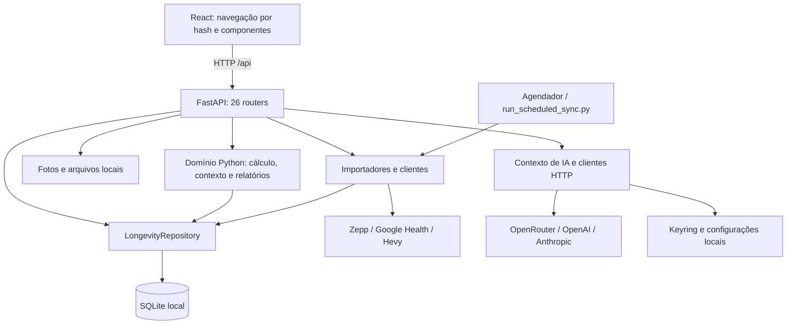

# Análise inicial completa — Longevidade Hub

**Data:** 8 de novembro de 2026, referência de calendário `America/Sao_Paulo`.  
**Projeto:** `E:\hermes\longevidade`.  
**Responsável:** artemis.  
**Versão declarada no código:** `2.4.6`.  
**Base Git:** branch `main`, commit `16a1b3e`, de 03/11/2026, acrescida das alterações locais existentes.  
**Natureza:** diagnóstico técnico inicial com inspeção de código, testes e reproduções isoladas; não é validação clínica, pentest nem autorização de publicação.

## 1. Parecer executivo

O Longevidade Hub é uma aplicação pessoal de saúde com implementação substancial: reúne métricas de wearables, exames, avaliações físicas com fotos, treinos, suplementos, contexto temporal, relatórios e IA. A organização em frontend React, API FastAPI, domínio Python e SQLite é adequada ao uso pessoal local. Há boas proteções contra dados ausentes, separação de proveniência laboratorial, testes extensos e componentes reutilizáveis de interface.

O estado analisado **compila e passa nas suítes unitárias e de integração existentes**, mas **ainda possui falhas relevantes de integridade de cálculo, configuração de acesso, documentação e validação de interface**. Os testes aprovados não cobrem todos os comportamentos que determinam a confiabilidade dos resultados de saúde.

As prioridades são:

1. Unificar unidades e resolução de idade antes de calcular PhenoAge. Foram reproduzidos resultados diferentes para painéis equivalentes e uso indevido da idade padrão de 40 anos.
2. Rever o acesso HTTP: o inicializador usa `0.0.0.0`, enquanto a aplicação não tem autenticação geral.
3. Alinhar o comportamento real da IA com a proteção anunciada: chat e insights chamam o provedor diretamente, sem aplicar as travas determinísticas presentes no módulo de segurança.
4. Separar dados demonstrativos da inicialização normal e rejeitar bancos de versões futuras sem alterar seu identificador de versão.
5. Restaurar os critérios de qualidade de interface: auditoria do design system, seletores E2E, inicialização dos testes e overflow em 320 px.

**Resultado das verificações principais:** 398 testes Python aprovados; 386 testes frontend aprovados; build aprovado; auditoria de design reprovada; seleção de 24 testes de navegador com 20 aprovações e quatro falhas, discriminadas na seção 8.

Não foram realizadas correções no código funcional nesta análise. O trabalho produzido está restrito a esta documentação, suas evidências e às referências de leitura obrigatória em `AGENTS.md` e `AGENTS.ms`.

## 2. Escopo, método e limites

### 2.1 O que foi examinado

- Estrutura do repositório, instruções locais, README, documentação de arquitetura, operação, limitações e design system.
- Configuração de inicialização, CORS, montagem de rotas, variáveis de ambiente e execução agendada.
- Esquema, migrações, conexões SQLite, repositório, proveniência e principais fluxos de persistência.
- Ingestão laboratorial, PhenoAge, KDM, indicadores derivados, N-of-1, CGM, contexto, relatórios e integrações.
- Navegação, carregamento de dados, tratamento de erro, componentes e controles de interface.
- Clientes e configuração de IA, fluxo de consentimento, armazenamento de credenciais, upload e armazenamento de fotografias.
- Suítes automatizadas, configuração de CI e comportamento real de verificações selecionadas.

A cobertura foi estrutural em todo o projeto e aprofundada nos pontos críticos. Não houve revisão manual linha a linha de todos os arquivos. A lista de testes executados e as limitações abaixo delimitam a evidência disponível.

### 2.2 Preservação e isolamento

Antes das validações, havia **74 arquivos rastreados modificados, dois excluídos e 14 arquivos não rastreados**, considerando `git status --porcelain=v1 --untracked-files=all`. O diff rastreado tinha 76 arquivos afetados. Essas alterações são anteriores a esta tarefa; o relatório descreve a árvore de trabalho, não somente o último commit.

Foi calculado um manifesto SHA-256 de 573 arquivos preexistentes rastreados ou não ignorados. A comparação após as validações não identificou alteração nesses arquivos. A alteração deliberada posterior em `AGENTS.md` apenas acrescenta a leitura obrigatória.

Os testes Python usaram as fixtures existentes e variáveis de ambiente temporárias de proteção. As reproduções adicionais usaram bancos criados em diretórios temporários. O build foi direcionado a `%TEMP%`, preservando `frontend/dist`. Os testes de navegador selecionados interceptam `/api/**` com dados sintéticos.

Não foram acionadas sincronizações reais, chamadas pagas a LLM, alterações de credenciais, agendamentos, migrações do banco operacional, push ou publicação. Não foi necessário abrir prontuários, fotos pessoais ou arquivos de tokens reais.

### 2.3 O que permanece não verificado

- Saúde, integridade e conteúdo do banco operacional do usuário; os resultados de SQLite deste documento são de bancos sintéticos.
- OAuth real, validade de tokens e compatibilidade atual dos contratos externos de Google Health, Zepp, Hevy e provedores de IA.
- Restauração de backup operacional, comportamento sob carga, concorrência entre processos e disponibilidade contínua.
- Execução do CI remoto, instalação do zero em máquina limpa e matriz completa de versões Python/Node.
- Revisão científica independente de cada fórmula, coeficiente, alvo clínico ou interpretação estatística.
- Auditoria completa WCAG, uso com leitor de tela e comparação visual de todas as telas nos dois temas.
- Varredura de vulnerabilidades de dependências e histórico completo do Git em busca de segredos.

Os estados `ready`, `complete` e `calculated` são contratos internos do software; não equivalem a aprovação clínica.

## 3. Inventário e ambiente

### 3.1 Dimensão observada

| Área | Dimensão |
|---|---:|
| Backend Python | 28 arquivos, 5.265 linhas |
| Routers FastAPI | 26 arquivos |
| Domínio em `src/longevidade` | 62 arquivos Python, 19.026 linhas |
| Frontend em `frontend/src` | 207 arquivos `.ts`/`.tsx`, 41.127 linhas, incluindo testes |
| Testes Python | 67 arquivos `test_*.py`, 398 casos executados |
| Testes Vitest | 71 arquivos executados, 386 casos |
| Especificações Playwright | Oito arquivos `.spec.ts` |
| Operações nos routers | 118 decoradores HTTP identificados por AST |
| Operações adicionais em `main.py` | Quatro aliases e duas rotas de saúde/versão |
| Esquema SQLite inicializado | 35 tabelas de aplicação, 19 migrações |
| Catálogo de exercícios semeado | 1.324 exercícios |
| Catálogo de indicadores derivados | 67 indicadores em sete categorias |

As 124 operações HTTP contabilizadas excluem as rotas automáticas de documentação e o serviço estático. As contagens de código não incluem dependências instaladas.

### 3.2 Stack e versões

| Componente | Estado observado |
|---|---|
| Produto | `2.4.6` em `version.py`, `pyproject.toml` e `frontend/package.json` |
| Python local | 3.14.6; requisito declarado `>=3.10`; CI usa 3.11 |
| Backend instalado | FastAPI 0.142.2, Starlette 1.7.0, Pydantic 2.13.5, Uvicorn 0.54.0 |
| Cálculo instalado | NumPy 2.5.3, SciPy 1.18.1 |
| Node/npm locais | Node 26.13.0, npm 12.0.2; CI usa Node 22 |
| Interface instalada | React 19.3.1, Vite 8.3.5, TypeScript 5.9.3, Tailwind CSS 4.3.3, Recharts 3.10.1 |
| Testes instalados | Pytest 9.1.1, Vitest 5.0.5, Playwright 1.64.1 |

São versões lidas do ambiente, sem afirmação de serem as versões mais recentes. `pip check` não encontrou requisitos quebrados; `npm ls --depth=0` não apontou dependências inválidas. Isso não é auditoria de vulnerabilidades.

O frontend possui `package-lock.json`. As dependências Python usam limites inferiores em dois manifestos, sem lockfile identificado na raiz. A diferença entre ambiente local e CI merece uma política explícita de versões suportadas.

## 4. Arquitetura e execução



| Caminho | Responsabilidade |
|---|---|
| `frontend/src/App.tsx` | Estado global de tela, consultas do dashboard, navegação, sincronização e orquestração dos modais |
| `frontend/src/components` | Telas, primitivas, modais, gráficos e formulários |
| `frontend/src/lib/api.ts` | `requestJson`, validação de resposta HTTP e `ApiError` |
| `backend/app/main.py` | Lifespan, migrações no início, reconciliação de timeline, CORS, rotas e arquivos estáticos |
| `backend/app/config.py` | Caminhos internos e resolução dinâmica de `LONGEVIDADE_DB_PATH` |
| `src/longevidade/db` | Esquema, migrações versionadas e persistência |
| `src/longevidade/algorithms`, `calculators`, `metrics` | Cálculos e contratos de indicadores |
| `src/longevidade/context` | Eventos, agregações temporais, baselines, mudanças e associações |
| `src/longevidade/ingestion`, `integrations` | Ingestão e clientes de dados externos |
| `src/longevidade/assessments` | Avaliações físicas e armazenamento de fotografias |
| `src/longevidade/ai`, `reports` | IA, proteção de segredos e relatórios Markdown/PDF |
| `integrations/zepp`, `integrations/google` | Scripts e adaptadores auxiliares internos ao repositório |
| `scripts` | Inicialização auxiliar do navegador e sincronização agendada |

### 4.1 Inicialização efetiva

`run_app.bat` cria a venv se necessário, instala dependências Node apenas quando `frontend/node_modules` não existe e compila a interface apenas quando `frontend/dist` não existe. Em uma venv existente, a verificação de atualização se limita ao import de `cryptography`. Não há reconciliação geral entre manifestos e pacotes instalados.

O servidor é iniciado com `--host 0.0.0.0 --port 8887 --reload`. A interface integrada fica na porta 8887; o Vite de desenvolvimento usa 8886 e encaminha `/api` para 8887. A suíte Playwright usa 3030.

O banco é inicializado no lifespan do FastAPI, não no simples import de `main.py`. O lifespan também tenta reconciliar a timeline, mas descarta qualquer exceção dessa etapa. `/api/health` informa se o arquivo de banco existe; não executa uma consulta para provar conectividade ou integridade.

### 4.2 Adequação arquitetural

O monólito modular é uma escolha coerente para uma aplicação pessoal. SQLite, FastAPI e um frontend estático permitem operação simples, e não há justificativa identificada para introduzir microserviços nesta fase.

Os principais limites estão na concentração de responsabilidades e na existência de caminhos paralelos para representar os mesmos dados. `repository.py` tem 2.270 linhas; o cliente Google Health, 1.648; o catálogo derivado, 1.109; `App.tsx`, 1.076; e o motor derivado, 958. A recomendação é extrair serviços e contratos nas áreas que receberem mudanças, preservando a estrutura atual e os testes.

## 5. Funcionalidades e fluxos

### 5.1 Navegação e experiência

Há seis áreas primárias: Hoje, Saúde, Treinos, Intervenções, IA e Copiloto, e Perfil. Subtelas incluem exames, sono, passos, timeline, avaliações físicas, suplementos, N-of-1, integrações e sistema. A navegação usa hash e persiste a aba ativa em `localStorage`.

Existem carregamento sob demanda com `React.lazy`/`Suspense`, `ErrorBoundary`, tema claro/escuro, primitivas de modal, drawer, formulário, toast e estados de vazio/erro. O dashboard apresenta ausência de métricas com `—`, em vez dos números fictícios descritos em documentação antiga.

`requestJson` verifica status HTTP e conteúdo JSON. Entretanto, várias consultas opcionais em `App.tsx:334` convertem falhas em `[]` ou `null`, tornando alguns erros indistinguíveis de ausência legítima de dados. A sequência de atualização protege contra respostas antigas sobrescrevendo consultas mais recentes.

### 5.2 Wearables, treinos e sincronização

- **Zepp:** importador, normalização, qualidade, sincronização incremental/histórica e scripts auxiliares internos. Há trava de sincronização com `threading.Lock` no processo HTTP.
- **Google Health:** cliente modular, registry de tipos, OAuth com state de uso único e TTL, renovação, consentimento parcial, estado incremental e armazenamento de pontos brutos. O módulo antigo em `ingestion/google_health_client.py` reexporta o cliente modular para compatibilidade.
- **Hevy:** API de treinos, perfil, paginação, normalização e persistência de exercícios/séries.
- **Agendamento:** script independente e instalador Windows para 07:00 e 21:00, com execução oculta via VBS. O código de configuração existe; a presença e a execução da tarefa no Windows não foram consultadas.

Os testes cobrem diversos contratos de integração por simulação. Não provam que credenciais reais estejam válidas. A trava em memória não coordena automaticamente o servidor, o processo agendado e eventuais múltiplos workers.

### 5.3 Exames, PhenoAge e KDM

O fluxo de exames aceita lotes, normaliza aliases, armazena origem e disponibiliza exportação CSV/JSON. PhenoAge exige nove marcadores e possui seleção de painel completo de uma mesma data. Origens clínicas elegíveis são `patient_lab` e `imported`; dados `synthetic`, `fixture`, `demo` e `unverified` não devem compor esses cálculos clínicos.

Essas proteções são positivas, mas o fluxo de ingestão tradicional ainda não converte unidades antes de construir o painel PhenoAge, e a idade padrão de 40 anos permanece na rota de lote. As reproduções estão em A01 e A02.

O KDM dedicado usa histórico e critérios mínimos para ajuste, retornando estado incompleto quando não há dados suficientes. Ele usa o histórico disponível do usuário; não foi demonstrada nesta análise equivalência de calibração com uma coorte externa. A expressão “KDM real via BioAge” no código descreve a intenção da implementação, não uma certificação independente.

### 5.4 Novo catálogo de indicadores derivados

O estado local contém `derived_catalog.py`, `engine.py`, `unit_conversion.py`, um router de biomarcadores e painel frontend. São **67 definições**:

| Categoria | Definições |
|---|---:|
| Idade biológica | 14 |
| Metabolismo/insulina | 10 |
| Inflamação/imunidade/nutrição | 11 |
| Hepática | 6 |
| Cardiovascular/renal | 13 |
| Composição corporal | 8 |
| Biomarcadores diretos | 5 |

O catálogo declara 51 entradas `ready`, 13 `needs_reference`, duas `needs_definition` e uma `restricted`. Portanto, **67 definições não significam 67 cálculos disponíveis ou clinicamente validados**. O motor retorna bloqueios e faltas de entrada; há exceções condicionais, como APRI com limite superior de AST fornecido.

O novo motor normaliza unidades, registra versão de algoritmo, entradas, limitações e fonte, e pareia antropometria em janela de até sete dias. Essa implementação deve se tornar referência compartilhada também para os caminhos anteriores. Hoje, a coexistência de pipelines permite discrepâncias entre resultados derivados e registros PhenoAge tradicionais.

`GET /api/biomarkers/derived` calcula e persiste resultados. Além de efeitos de escrita em uma consulta GET, há limites de busca de exames e avaliações que podem excluir dados antigos. Isso deve ficar explícito no contrato e ser coberto por testes de datas históricas.

### 5.5 CGM, N-of-1 e contexto

CGM possui ingestão de leituras/CSV, persistência de dados brutos e sumários. A função de resumo calcula a proporção de leituras entre 70 e 140 mg/dL. Como recebe valores sem intervalos temporais, o nome “tempo na faixa” pressupõe amostragem regular; para dados irregulares, falta ponderação por duração e informação de cobertura.

N-of-1 compara períodos com teste t de Welch e d de Cohen, exige pelo menos três observações em cada conjunto e rejeita sobreposição de períodos na rota. O caso de variância praticamente nula usa valor de efeito convencional de magnitude 10 quando as médias diferem. Esse valor deve ser identificado como convenção de implementação, não como estimativa irrestrita de precisão.

Timeline e contexto adicionam eventos, reconciliação, baselines robustos, detecção de mudanças, associações pessoais e análise de confundidores. Essas saídas são observacionais; a análise não verificou suporte a inferência causal, correção geral para múltiplas comparações ou autocorrelação temporal.

### 5.6 Avaliações, suplementos e relatórios

Avaliações físicas possuem medições, histórico, comparação, fotos por ângulo/estado e exportação. O serviço verifica imagem com Pillow, remove EXIF, usa nomes gerados, hash SHA-256 e validação de contenção de caminho. Há limite de 15 MB por imagem e 20 fotos por avaliação. O router lê o upload inteiro antes de o serviço conferir o limite, o que limita a proteção de memória contra entradas muito grandes.

Suplementos/intervenções possuem cadastro, registros de tomada, auditoria e conformidade. O principal problema identificado nesse domínio é a semeadura de cinco suplementos ativos na inicialização de um banco vazio, descrita em A05.

Doctor Briefing gera Markdown/PDF a partir dos dados persistidos; exportações laboratoriais e de fotos também existem. Esses recursos são exportações parciais e não constituem backup completo restaurável da aplicação.

### 5.7 IA e privacidade

O dispatcher implementa OpenRouter, OpenAI e Anthropic. O frontend mostra confirmação de envio externo e modo de privacidade; o contexto `minimal` reduz identificadores e histórico, mas continua contendo dados de saúde. Não é anonimização garantida.

Há código de segurança determinística e testes de suas funções. Porém, os endpoints de chat e geração de insights não aplicam essa decisão antes da chamada ao LLM; os testes atuais inclusive esperam esse comportamento. Não há suporte implementado no dispatcher para todos os provedores anunciados no cartão de sistema da interface.

As novas chaves de IA usam Keyring. Isso não se estende uniformemente a todas as integrações: Google e Zepp escrevem JSON local, e Hevy grava também um arquivo de fallback mesmo quando a gravação no Keyring ocorre. A análise verificou o mecanismo de código, sem ler segredos reais.

## 6. Dados, persistência e integridade

### 6.1 Organização do banco

| Grupo | Tabelas principais |
|---|---|
| Perfil e configuração | `user_profile`, `ai_settings` |
| Medições e qualidade | `daily_metrics`, `daily_metric_quality`, `manual_entries`, `daily_checkins` |
| Laboratório e modelos | `lab_results`, `phenoage_records`, `kdm_records`, `derived_metric_records` |
| CGM | `cgm_readings`, `cgm_daily_summary` |
| Protocolos | `supplement_stack`, `supplement_logs`, `supplement_audit_logs`, `interventions`, `n_of_1_experiments`, `protocol_compliance` |
| Treinamento | `workouts`, `workout_exercises`, `workout_sets`, `exercise_catalog`, `exercise_mappings` |
| Integração | `pipeline_run`, `google_health_sync_state`, `health_data_points` |
| Contexto | `health_events`, `health_events_backfill_state`, `personal_associations`, `metric_change_points`, `insight_feedback` |
| Avaliação física | `physical_assessments`, `physical_assessment_photos` |
| IA gerada | `ai_insights_history`, `ai_reports` |

O repositório fecha conexões explicitamente, usa timeout de 30 segundos e ativa `foreign_keys`. O SQL observado usa parâmetros para valores e listas controladas de colunas nos upserts. A suíte contém testes de migração, idempotência, proveniência e isolamento.

### 6.2 Reprodução em banco sintético

| Verificação | Resultado |
|---|---|
| Migrações aplicadas | `user_version = 19` |
| Integridade SQLite | `PRAGMA integrity_check = ok` |
| Integridade referencial | `PRAGMA foreign_key_check` vazio |
| Conexão do repositório | `PRAGMA foreign_keys = 1` |
| Banco novo chamado `data/longevity.sqlite3` | `journal_mode = delete` |
| Mesmo banco após reinicialização completa | `journal_mode = wal` |
| Suplementos ativos em banco novo | 5 |
| Tabela de suplementos esvaziada e banco reinicializado | 5 novamente |
| Versão sintética 999 entregue a `apply_migrations` | Regravada como 19 |

O modo WAL inconsistente decorre da cópia de um template criado com outro nome. A configuração de WAL só roda no caminho de inicialização completa para o nome/diretório esperado. Não foi verificado o modo atual do banco operacional.

### 6.3 Proveniência e concorrência

`daily_metrics` tem uma linha por data; o upsert preserva valores anteriores quando a entrada é `NULL`, mas pode atualizar o campo global `source` para a última fonte recebida. Uma linha com campos de origens diferentes pode acabar com um único rótulo. Existe `daily_metric_quality` por métrica, mas a cobertura desse metadado em todos os importadores não foi provada.

O lock de sincronização é local ao processo. WAL e `busy_timeout` ajudam no acesso ao SQLite, mas não substituem exclusão mútua entre coletor HTTP e processo agendado. A política de precedência entre fontes, retificação e apagamento de valores merece contrato explícito.

Não foi encontrado um fluxo completo de backup/restauração em backend, domínio, scripts ou seção Sistema. Para um backup com o banco aberto, a API de backup do SQLite fornece uma cópia consistente; copiar apenas o arquivo principal sem coordenar o estado de WAL não é uma estratégia suficiente. Fotos e configurações também precisam integrar o plano de restauração. [Documentação oficial de backup](https://sqlite.org/backup.html) e [WAL](https://sqlite.org/wal.html).

## 7. Achados priorizados e ações propostas

**Critério:** P1 = risco relevante para dados, resultados ou acesso; P2 = confiabilidade, manutenção e experiência; P3 = melhoria estrutural. A prioridade não implica exploração externa comprovada. “Confirmado” identifica leitura de código ou reprodução; “a validar” identifica consequência ainda não exercitada.

### A01 — P1 — PhenoAge tradicional ignora a unidade informada no lote

**Confirmado por reprodução.** `normalize_lab_record` normaliza a chave, não a unidade. `ingest_lab_records` monta o painel com números extraídos, e `calculate_phenoage` assume as unidades canônicas.

Com os mesmos nove marcadores, idade de 40 anos e a mesma data de coleta, mudar apenas glicose de **90 mg/dL** para **4,995 mmol/L**, equivalente segundo o fator usado pelo próprio código, produziu:

| Entrada da glicose | PhenoAge retornado | Estado |
|---|---:|---|
| 90 mg/dL | 30,83 | `complete` |
| 4,995 mmol/L | 20,61 | `complete` |

São resultados sintéticos usados exclusivamente para demonstrar a inconsistência. **Ação:** normalizar unidades antes de qualquer cálculo e reaproveitar `metrics/unit_conversion.py`; rejeitar unidades desconhecidas. **Aceite:** painéis equivalentes geram o mesmo resultado nos caminhos de lote, cálculo, painel derivado e relatório.

**Evidência:** [lab_normalization.py](../src/longevidade/ingestion/lab_normalization.py), linha 328; [lab_parser.py](../src/longevidade/ingestion/lab_parser.py), linhas 124–202; [phenoage_panel.py](../src/longevidade/algorithms/phenoage_panel.py), linha 53.

### A02 — P1 — Idade padrão de 40 anos pode substituir idade conhecida

**Confirmado por reprodução.** `BatchLabInput.chronological_age` e a função de ingestão usam 40 como padrão. O valor só é corrigido pela ingestão quando existe nascimento válido. Um perfil sintético com `chronological_age = 65`, sem nascimento e sem idade explícita no lote, gerou cálculo com `chronological_age = 40`.

**Ação:** definir resolução única: idade na data da coleta a partir do nascimento, ou idade explicitamente válida e datada; ausência deve gerar estado incompleto. **Aceite:** nunca inventar idade quando não houver informação suficiente, e usar corretamente o perfil quando esse for o contrato aprovado.

**Evidência:** [labs.py](../backend/app/routers/labs.py), linhas 28–66; [lab_parser.py](../src/longevidade/ingestion/lab_parser.py), linhas 124 e 190–202.

### A03 — P1 — Servidor acessível pela rede sem autenticação geral

**Confirmado no código/configuração; alcance real da rede não testado.** O launcher usa `0.0.0.0`. Não há autenticação geral envolvendo os routers de prontuário, fotos, mutações e configuração. As verificações específicas do webhook Google não protegem o restante da API. A expressão regular de CORS aceita redes privadas, além de loopback.

**Ação:** adotar loopback por padrão. Para acesso por outro dispositivo, estabelecer autenticação, autorização e transporte apropriado antes de manter o bind na rede. CORS controla comportamento de navegadores e não autentica clientes HTTP. **Aceite:** clientes não autorizados não conseguem ler nem alterar dados.

**Evidência:** [run_app.bat](../run_app.bat), linha 46; [main.py](../backend/app/main.py), linhas 71–130.

### A04 — P1 — Proteção determinística anunciada não está no caminho da IA

**Confirmado em código e testes existentes.** `generate_insights` e `chat_copilot` chamam `generate_llm_response` diretamente e retornam `guardrail_applied: false`. `_current_training_safety` existe, mas não é aplicada por esses endpoints. Os testes `calls_llm_directly_without_guardrails` e `calls_llm_directly_for_training_inquiry_without_guardrails` formalizam esse comportamento.

**Ação:** decidir explicitamente o contrato do produto e alinhar implementação, testes e documentação. Se as travas forem requisito, aplicá-las no fluxo efetivo e testar ausência de chamada externa nos cenários bloqueados. **Aceite:** a UI não anuncia uma proteção que os endpoints não executam.

**Evidência:** [ai.py](../backend/app/routers/ai.py), linhas 89, 192–216 e 289–350; [test_ai_guardrail.py](../tests/test_ai_guardrail.py), linhas 44–96.

### A05 — P1 — Inicialização insere suplementos ativos sem cadastro do usuário

**Confirmado por reprodução.** `_run_full_initialization` insere cinco suplementos com doses, horários e datas fixas quando `supplement_stack` está vazia. A inserção também reaparece após esvaziamento físico da tabela e reinicialização completa. A remoção lógica pela interface não foi confundida com esse esvaziamento físico.

**Ação:** remover dados demonstrativos da inicialização normal e oferecer demonstração isolada somente por opção explícita. Não apagar registros existentes sem distinguir origem e autorização. **Aceite:** primeiro uso sem protocolos pessoais aparece vazio e não informa adesão a um tratamento fictício.

**Evidência:** [schema.py](../src/longevidade/db/schema.py), linhas 69–83.

### A06 — P1 — Migração rebaixa silenciosamente versão desconhecida

**Confirmado por reprodução.** Um banco sintético completo com `PRAGMA user_version=999` foi regravado como 19. Isso muda o identificador de versão sem provar compatibilidade com um esquema futuro. Há ainda caminhos de reparo que reduzem a versão para 10 e toleram determinados erros de tabela/coluna.

**Ação:** rejeitar versão superior à suportada antes de qualquer escrita; separar reparo de esquema e migração normal. **Aceite:** tentativa com versão futura falha claramente e preserva arquivo e versão. Os testes atuais de migração não demonstram essa garantia.

**Evidência:** [migrations.py](../src/longevidade/db/migrations.py), linhas 756–789. `user_version` é um identificador administrado pela aplicação, conforme a [documentação SQLite](https://sqlite.org/pragma.html#pragma_user_version).

### A07 — P2 — Auditoria do design system reprova o estado atual

**Confirmado por execução, código de saída 1.**

| Regra | Ocorrências abertas | Baseline | Excesso |
|---|---:|---:|---:|
| `typography.micro-11` | 2 | 0 | 2 |
| `effects.backdrop-blur` | 1 | 0 | 1 |
| `native.button` | 96 | 93 | 3 |
| `native.select` | 2 | 0 | 2 |

Exemplos: texto de 11 px em `PhenoAgeWidget.tsx:390/394`; blur em `SideBySideLightbox.tsx:121`; selects nativos em `DerivedBiomarkersPanel.tsx:246/266`. As 96 ocorrências de botão são contagem total aberta; não significam 96 regressões novas.

**Ação:** aplicar primitivas/tokens ou registrar exceção justificada quando apropriado, sem aumentar o baseline apenas para ocultar falhas. **Aceite:** `npm run audit:design-system` retorna zero. O CI contém essa etapa e reprovaria o estado correspondente.

### A08 — P2 — Testes E2E desatualizados e espera de servidor incompleta

**Confirmado.** Focus stacking e parte dos fluxos de teclado procuram `Registrar Métrica` e `Doctor Briefing`, enquanto os nomes acessíveis atuais são `Registrar medição manual` e `Resumo para consulta`. O smoke de sincronização procura `sincronizar dados|sync zepp`, mas o botão se chama `Sincronizar`.

O `webServer` do Playwright não define URL de prontidão. Uma execução começou com `ERR_CONNECTION_REFUSED`; a repetição isolada com `webServer.url` passou no carregamento básico. Essa falha de infraestrutura não foi classificada como defeito funcional do dashboard.

**Ação:** atualizar os seletores para o contrato acessível vigente e esperar a URL do servidor. **Aceite:** os testes chegam às ações e verificações reais, em vez de esgotar timeout procurando rótulos antigos.

**Evidência:** [focus-stacking.spec.ts](../frontend/e2e/focus-stacking.spec.ts), linhas 63–108; [smoke.spec.ts](../frontend/e2e/smoke.spec.ts), linha 256; [playwright.config.ts](../frontend/e2e/playwright.config.ts); [HeaderUtilityActions.tsx](../frontend/src/components/HeaderUtilityActions.tsx).

### A09 — P2 — Overflow horizontal confirmado em 320 px

**Confirmado por Playwright e captura inspecionada.** Em Chromium com viewport de 320 × 568, a tela Hoje apresentou `documentElement.scrollWidth = 338`, acima dos 320 px disponíveis. A telemetria apontou o grupo de controles técnicos do cabeçalho, inclusive botões/ícone à direita.

**Ação:** permitir acomodação do grupo e revisar a aplicação das classes responsivas de `SyncStatusBadge` e do cabeçalho. **Aceite:** documento e controles permanecem dentro da viewport, preservando alvos de interação. Não basta esconder o overflow globalmente.

**Evidência visual sintética:** [overflow-320px.png](analises/2026-11-08/overflow-320px.png). Referências: [HeaderUtilityActions.tsx](../frontend/src/components/HeaderUtilityActions.tsx), [SyncStatusBadge.tsx](../frontend/src/components/ui/SyncStatusBadge.tsx) e [viewport-matrix.spec.ts](../frontend/e2e/viewport-matrix.spec.ts), linha 318.

### A10 — P2 — “Visual regression” captura novas imagens, sem comparação de pixels

**Confirmado no código.** `visual-regression.spec.ts` grava screenshots e metadados em `docs/screenshots/baselines`, depois verifica presença de conteúdo/ausência de erros textuais. Não há comparação visual com referência aprovada nessa especificação. O CI executa o arquivo como regressão visual.

**Ação:** separar geração de baseline e validação; estabelecer comparação e atualização deliberada de referências. **Aceite:** uma mudança visual deliberadamente incorreta reprova sem sobrescrever a referência. Essa especificação não foi executada nesta análise para preservar os baselines existentes.

**Evidência:** [visual-regression.spec.ts](../frontend/e2e/visual-regression.spec.ts), linhas 334–444; [ci.yml](../.github/workflows/ci.yml).

### A11 — P2 — Inicializador pode servir build ou dependências antigos

**Confirmado no código.** A presença de `dist` impede nova compilação; a presença de `node_modules` impede reinstalação; uma venv existente é considerada suficiente pelo import de uma biblioteca. O script também não interrompe explicitamente todas as etapas após erros de instalação/build.

**Ação:** separar bootstrap, desenvolvimento e execução integrada; detectar alterações de manifestos/fontes ou exigir comandos claros de atualização. **Aceite:** a versão servida corresponde às fontes e falhas de preparação interrompem a inicialização com diagnóstico útil.

**Evidência:** [run_app.bat](../run_app.bat), linhas 13–46.

### A12 — P2 — Backup/restauração completo e política de retenção ausentes

**Constatação de escopo do código pesquisado.** Há exportações específicas, mas não um procedimento implementado de restauração conjunta de banco, fotos e configuração. A existência de backups externos do usuário não foi investigada.

**Ação:** criar backup consistente, manifesto, verificação e ensaio de restauração em diretório isolado; definir retenção de dados brutos, fotos, relatórios e logs. **Aceite:** uma cópia restaurada abre e preserva relações entre avaliações, fotos e registros, sem sobrescrever a instalação original.

### A13 — P2 — Cofre de segredos não é uniforme entre integrações

**Confirmado no código.** Keyring protege novas chaves de IA, mas Google e Zepp persistem credenciais em JSON, e Hevy grava um JSON adicional. O `.gitignore` reduz versionamento acidental, mas não cifra conteúdo nem restringe acesso ao arquivo.

**Ação:** definir estratégia única de armazenamento e migração reversível; usar permissões apropriadas e apresentar claramente o nível de proteção. **Aceite:** evitar cópias em texto simples desnecessárias e testar leitura/migração sem expor segredos. Nenhum segredo foi lido ou alterado nesta análise.

**Evidência:** [secrets_store.py](../src/longevidade/ai/secrets_store.py); [hevy_client.py](../src/longevidade/ingestion/hevy_client.py), linha 71 em diante; [cliente Google](../src/longevidade/integrations/google_health/client.py), linha 110; [zepp.py](../backend/app/routers/zepp.py), linha 83.

### A14 — P2 — Falhas parciais podem parecer ausência normal de dados

**Confirmado por leitura.** A reconciliação da timeline captura qualquer exceção e prossegue sem diagnóstico. Consultas opcionais do dashboard convertem erros em listas vazias. O health check verifica existência do arquivo e não saúde da consulta.

**Ação:** manter disponibilidade parcial com estados por módulo, erro sanitizado, indicador de desatualização e logs identificáveis. **Aceite:** usuário e manutenção distinguem “sem registros”, “fonte não configurada”, “consulta falhou” e “dados antigos”.

**Evidência:** [main.py](../backend/app/main.py), linhas 77–85 e 140–147; [App.tsx](../frontend/src/App.tsx), linhas 334–344.

### A15 — P2 — Proveniência agregada e concorrência precisam de contrato

**Confirmado quanto à implementação; consequências entre processos ainda a validar.** O agregado diário usa um único `source`, e o lock de sincronização é em memória. Falta prova de coordenação entre execução HTTP e agendada, e de rastreabilidade por campo em todas as fontes.

**Ação:** documentar precedência/retificação e coordenar tarefas concorrentes; fazer a UI consumir proveniência por métrica quando disponível. **Aceite:** duas fontes e duas execuções concorrentes não produzem mistura sem origem rastreável ou resultados dependentes da ordem sem regra explícita.

**Evidência:** [repository.py](../src/longevidade/db/repository.py), linhas 453–487; [metrics.py](../backend/app/routers/metrics.py), linha 15; [run_scheduled_sync.py](../scripts/run_scheduled_sync.py).

### A16 — P2 — WAL e consultas derivadas têm comportamento operacional implícito

**Confirmado.** Banco novo copiado do template inicia em `delete`, mudando para WAL na inicialização completa posterior. A rota GET de biomarcadores persiste resultados ao consultar.

**Ação:** aplicar configuração de conexão/inicialização independentemente do nome do arquivo e separar cálculo/persistência de leitura ou documentar idempotência e custo. **Aceite:** modo de journaling previsível desde o primeiro uso e consultas sem escrita inesperada para o cliente.

**Evidência:** [schema.py](../src/longevidade/db/schema.py), linhas 39–40 e 97–117; [biomarkers.py](../backend/app/routers/biomarkers.py), função `get_derived_biomarkers`.

### A17 — P2 — Documentação e mensagens do produto divergem da implementação

**Confirmado.** A documentação ainda menciona versões e contagens antigas, caminhos de projetos irmãos, inicialização no import e host loopback. Há descrições de bugs já corrigidos e promessas não sustentadas pelo dispatcher atual.

O README chama PhenoAge/KDM de idade “epigenética”. O PhenoAge implementado usa exames sanguíneos; DNAm PhenoAge é um estimador distinto baseado em metilação. A publicação original separa esses dois estágios. A referência bibliográfica em `algorithms/phenoage.py` também precisa correção: o artigo indicado foi publicado em *Aging (Albany NY)*, 2018, 10(4):573–591, DOI 10.18632/aging.101414. [Publicação original](https://pmc.ncbi.nlm.nih.gov/articles/PMC5940111/).

**Ação:** atualizar os documentos por comportamento verificado e marcar relatórios antigos como históricos. Revisar textos de provedores e alvos clínicos. **Aceite:** arquitetura, limitações, instruções de execução e mensagens visíveis não contradizem o código corrente.

### A18 — P3 — Reprodutibilidade e distribuição precisam de definição

**Confirmado no inventário.** Python possui dependências repetidas e abertas por limite inferior; o CI usa `npm install`, enquanto o launcher usa `npm ci`; não há lock Python na raiz nem arquivo de licença na raiz, embora o README anuncie “Open-Source”. A licença e proveniência do catálogo/mídias também não foram auditadas.

**Ação:** definir ambientes suportados, instalações reproduzíveis e termos de distribuição antes de promover redistribuição pública. **Aceite:** clone limpo reproduz build/testes em ambiente documentado e há licença escolhida explicitamente pelo responsável. Esta análise não escolhe licença em nome do usuário.

### A19 — P3 — Módulos extensos e contratos frouxos aumentam custo de mudança

**Confirmado no inventário e leitura.** `App.tsx`, repositório, cliente Google e motor derivado concentram muitas decisões; há uso frequente de `any`/dicionários genéricos e parte da API não possui modelos de resposta detalhados.

**Ação:** extrair consultas e mutações por domínio, modelar respostas e centralizar normalização; fazer isso junto de mudanças funcionais justificadas. **Aceite:** mesmas funções e testes permanecem válidos, com contratos compartilhados e menor duplicação. Não é recomendada uma reescrita geral.

## 8. Validações executadas e interpretação

| Verificação | Resultado | Limite da evidência |
|---|---|---|
| `python -m pytest -q --tb=short` | **398 passaram**, 1 aviso, 88 s | Testes existentes em ambiente isolado; sem conexão autenticada real |
| `npm run test:run` | **386 passaram**, 71 arquivos, 22,06 s | jsdom; aviso de `HTMLCanvasElement.getContext` não implementado |
| `npm run build -- --outDir <temporário>` | **Aprovado**, incluindo TypeScript | Não substituiu o build operacional |
| `python -m pip check` | **Aprovado** | Compatibilidade de requisitos instalados, não CVEs |
| `npm ls --depth=0` | **Aprovado** | Dependências diretas instaladas |
| `npm run audit:design-system` | **Reprovado** | Quatro regras acima do baseline |
| Playwright, seleção de seis arquivos | **Interrompida** após três falhas de seletores em focus stacking e uma aprovação de teclado | Não apresentada como suíte concluída |
| Playwright, smoke + viewport matrix | **20 passaram / 4 falharam**, 24 casos, 1,3 min | Timeout de 10 s e zero retries; causas discriminadas abaixo |
| Playwright, confirmação com URL de prontidão | **1 passou / 2 falharam**, 36,6 s: carregamento aprovado; seletor e overflow confirmados | Configuração temporária, timeout padrão de 30 s, sem editar o projeto |
| Provas sintéticas de banco/ingestão | Reproduzidos A01, A02, A05, A06 e modo WAL de A16 | Dados sintéticos; não usados como avaliação pessoal |
| `git diff --check` preexistente | **Reprovado** por linhas vazias no EOF de três arquivos | Problemas anteriores a esta documentação |
| Manifesto SHA-256 antes/depois das validações | **Sem mudança nos 573 arquivos preexistentes** | Artefatos ignorados de teste/build não integram esse manifesto |

As quatro falhas da seleção de 24 casos foram: uma conexão recusada no primeiro carregamento desktop; dois timeouts de sincronização por seletor antigo, um por projeto; e um overflow de 338 px em viewport de 320 px no projeto Chromium. A confirmação com espera explícita removeu a falha de carregamento básico. Os resultados não devem ser somados entre execuções porque há casos repetidos.

O aviso Python é uma depreciação de `httpx` em `starlette.testclient`. Deve ser tratado conforme a matriz de dependências aprovada, sem troca automática de pacote baseada apenas no aviso.

O build produziu chunk principal de **362,77 kB / 104,97 kB gzip** e chunk de avaliações físicas de **486,74 kB / 131,35 kB gzip**. São tamanhos de saída, não medição de latência ou memória no navegador. Há divisão por telas; não foi observado o antigo bundle único descrito em parte da documentação.

As falhas preexistentes de `git diff --check` estão em `kdm_age.py:559`, `repository.py:2267` e `metrics/catalog.py:154`. Não foram corrigidas para evitar misturar limpeza de código com o diagnóstico.

### 8.1 Evidências preservadas

Os resultados desta análise ficam em [analises/2026-11-08](analises/2026-11-08/):

- [Índice de evidências e reproduções sintéticas](analises/2026-11-08/evidencias.json).
- [Pytest](analises/2026-11-08/pytest.txt), [Vitest](analises/2026-11-08/vitest.txt), [build](analises/2026-11-08/build.txt) e [auditoria de design](analises/2026-11-08/design-audit.txt).
- [Playwright interrompido](analises/2026-11-08/e2e-inicial.txt), [seleção concluída](analises/2026-11-08/e2e-selecao.txt) e [confirmação isolada](analises/2026-11-08/e2e-confirmacao.txt).
- [Captura sintética do overflow](analises/2026-11-08/overflow-320px.png).

Os logs não constituem promessa de aprovação de futuras alterações. Os caminhos temporários neles registrados são do ambiente desta execução.

## 9. Divergências com documentos anteriores

| Afirmação antiga | Estado atual confirmado |
|---|---|
| Métrica manual usa rota inexistente | `App.tsx` envia para `POST /api/metrics` |
| Foreign keys não ativadas no repositório | `_get_connection` executa `PRAGMA foreign_keys = ON` |
| PhenoAge preenche todos os marcadores ausentes | Ausência de marcador gera estado incompleto; permanecem os problemas de unidade e idade padrão |
| Banco inicializado no import de `main.py` | Inicializado no lifespan; há teste explícito para import sem inicialização |
| Dashboard mostra números fixos na falta de medições | Cartões principais mostram `—` |
| Dependência de projetos irmãos | Caminhos de integração atuais são internos ao repositório |
| Host do launcher é `127.0.0.1` | Launcher usa `0.0.0.0` |
| Proteção determinística impede chamadas de IA inseguras | Endpoints analisados chamam o provedor diretamente |
| Versão 0.6.0/2.2.0 e contagens antigas de testes | Código declara 2.4.6; foram executados 398 testes Python e 386 frontend |
| Regressão visual compara interface aprovada | Especificação gera novas capturas sem comparação de pixels |
| Cartão Sistema oferece Gemini/Groq/Ollama | Dispatcher implementa OpenRouter, OpenAI e Anthropic |

Documentos anteriores devem ser usados como histórico e intenção, não como prova do comportamento atual. Em divergências futuras, conferir o código e repetir a validação pertinente; este relatório também envelhecerá.

## 10. Plano de evolução recomendado

### Etapa 1 — Confiabilidade dos dados e fronteira de acesso

Tratar A01–A06 em mudanças separadas e revisáveis. Priorizar testes de equivalência de unidades, idade ausente, inicialização sem tratamentos fictícios e recusa de esquema futuro. Definir explicitamente se o uso é apenas local ou em rede. Preservar dados existentes e preparar reversão antes de qualquer migração operacional.

**Critério de saída:** nenhum resultado completo depende de unidade/idade presumida; dados de exemplo não aparecem como protocolo pessoal; versão de banco desconhecida não é regravada; acesso e comportamento de IA correspondem ao contrato escolhido.

### Etapa 2 — Restabelecer validação de interface

Corrigir A07–A10: nomes acessíveis nos testes, prontidão do servidor, overflow em 320 px e distinção entre capturar e comparar referências visuais. Manter estados vazios, falhas de API e navegação por teclado nos cenários críticos.

**Critério de saída:** build, testes unitários, auditoria e cenários E2E relevantes passam; baseline visual só muda por atualização revisada.

### Etapa 3 — Operação recuperável e observável

Tratar A11–A16: atualização previsível, backup/restauração, armazenamento de segredos, saúde por módulo, proveniência e concorrência. Exercitar restauração e sincronização sobre cópias sintéticas antes de aplicar em dados reais.

**Critério de saída:** instalação e recuperação reproduzíveis, erros parciais visíveis e dados com origem verificável.

### Etapa 4 — Documentação e manutenção contínua

Atualizar README, HERMES e documentos centrais, separar histórico de instrução vigente, definir distribuição/licença e consolidar contratos dos módulos extensos. Registrar referência, versão e limitações das fórmulas sem transformar alvos genéricos em prescrições individuais.

**Critério de saída:** um novo mantenedor consegue instalar, testar e entender os limites do sistema sem depender de descrições contraditórias.

## 11. Roteiro de leitura e comandos úteis

### 11.1 Leitura para manutenção

1. Este relatório e [AGENTS.md](../AGENTS.md).
2. [main.py](../backend/app/main.py), [config.py](../backend/app/config.py) e [run_app.bat](../run_app.bat).
3. [schema.py](../src/longevidade/db/schema.py), [migrations.py](../src/longevidade/db/migrations.py), [repository.py](../src/longevidade/db/repository.py) e [conftest.py](../tests/conftest.py).
4. [App.tsx](../frontend/src/App.tsx), [Header.tsx](../frontend/src/components/Header.tsx), [api.ts](../frontend/src/lib/api.ts) e [design system](DESIGN_SYSTEM.md).
5. Módulo de domínio e testes correspondentes à mudança pretendida.

### 11.2 Validação local em PowerShell

```powershell
Set-Location E:\hermes\longevidade
$env:PYTHONPATH = ''
.venv\Scripts\python.exe -m pytest -q --tb=short
.venv\Scripts\python.exe -m pip check

Set-Location E:\hermes\longevidade\frontend
npm run test:run
npm run typecheck
npm run audit:design-system
npm run test:e2e -- e2e/smoke.spec.ts e2e/viewport-matrix.spec.ts
```

Os comandos E2E e de auditoria reproduzem os bloqueios atuais; não são apresentados como aprovados. Em novos testes HTTP em `tests/`, usar obrigatoriamente o fixture `client`, sem `TestClient(app)` global. Para repetir provas de migração ou ingestão, usar sempre banco temporário, nunca `data/longevity.sqlite3`.

## 12. Fontes e rastreabilidade

A fonte principal deste diagnóstico é o código local da árvore de trabalho e os logs de validação preservados. As referências de linha correspondem ao estado de 08/11/2026 e podem mudar após edições.

As verificações externas foram restritas a documentação primária de SQLite e à publicação original sobre PhenoAge, para esclarecer conceitos específicos. A busca local prevista na skill `browser-search` não respondeu; foi usado o mecanismo web disponível como alternativa. Nenhum dado pessoal de saúde foi enviado nas consultas.

- [Levine et al., 2018 — An epigenetic biomarker of aging for lifespan and healthspan](https://pmc.ncbi.nlm.nih.gov/articles/PMC5940111/): distinção entre idade fenotípica clínica e estimador DNAm, além dos dados bibliográficos.
- [SQLite — Online Backup API](https://sqlite.org/backup.html): cópia consistente de banco aberto.
- [SQLite — Write-Ahead Logging](https://sqlite.org/wal.html): comportamento e arquivos associados a WAL.
- [SQLite — PRAGMA user_version](https://sqlite.org/pragma.html#pragma_user_version): identificador de versão gerido pela aplicação.

As recomendações de engenharia foram derivadas dos comportamentos observados. A validação clínica integral, a auditoria de segurança aprofundada e a implantação de correções permanecem trabalhos distintos deste diagnóstico.
